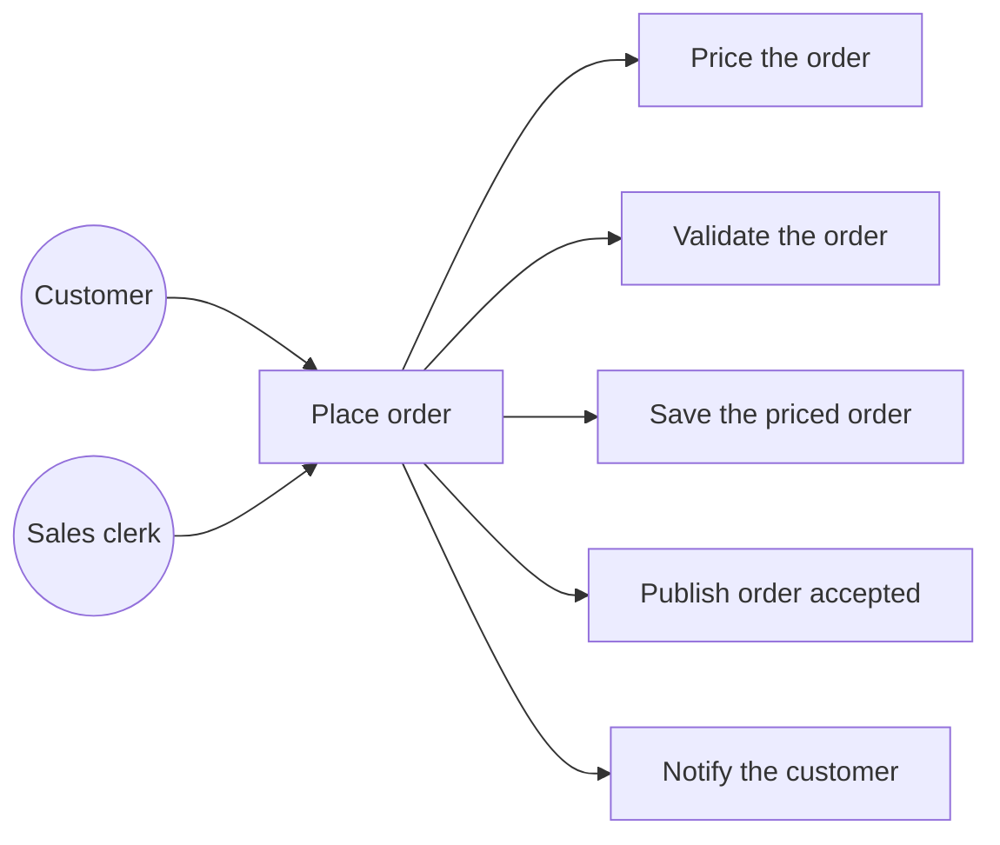
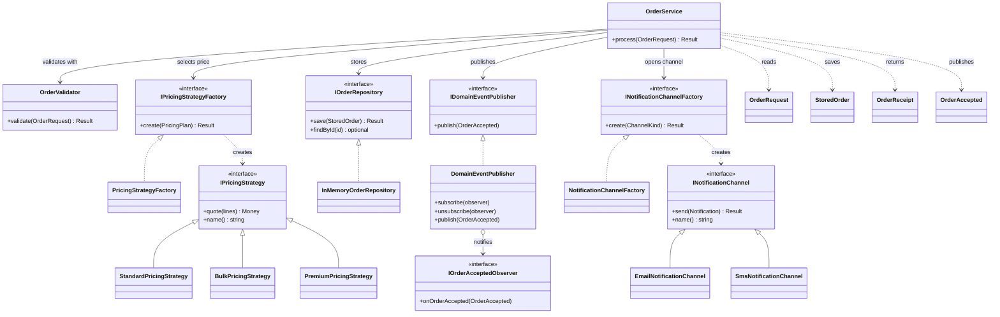
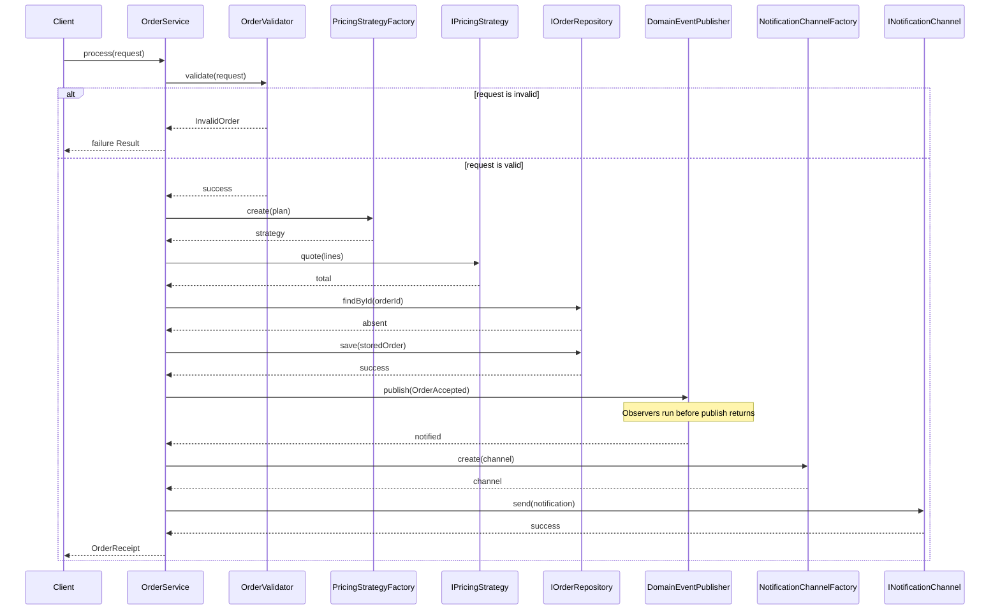
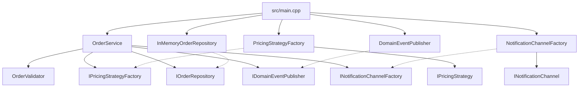

# UML

The diagrams use Mermaid. Mermaid's supported diagram types cover flowcharts,
class diagrams, and sequence diagrams. A textbook use-case ellipse diagram is
drawn here as a flowchart, which is the form Mermaid can render. The system
boundary is the place-order use case and the steps it includes.

Source of truth for names: the headers under `include/cs2511/`.

## Use cases

The customer and the sales clerk both start UC1, Place order. Pricing,
validation, saving, publication, and notification are included steps. They are
specified in `docs/requirements.md`.

## Class diagram

`OrderService` depends on interfaces and on the validator. Concrete strategies,
the in-memory repository, and the two channels sit under those interfaces.
`DomainEventPublisher` both implements the publish port and holds observers.
The service never sees the observer interface.

## Sequence: process an order

A failed `save` returns on the `Repo` arrow and does not call `publish` or
`send`. A failed `send` returns `NotificationFailed` after `publish` has
already run. Those branches are assertions in `tests/test_order_service.cpp`.

## Dependencies

Solid arrows are "uses." Dashed arrows are "implements." The composition root
is the only production file that sees both the service and the concrete
adapters.

`examples/before-refactor/OrderProcessor` does not appear. It does not depend
on these ports, and the ports do not depend on it. The test binary is the one
target that links both.
